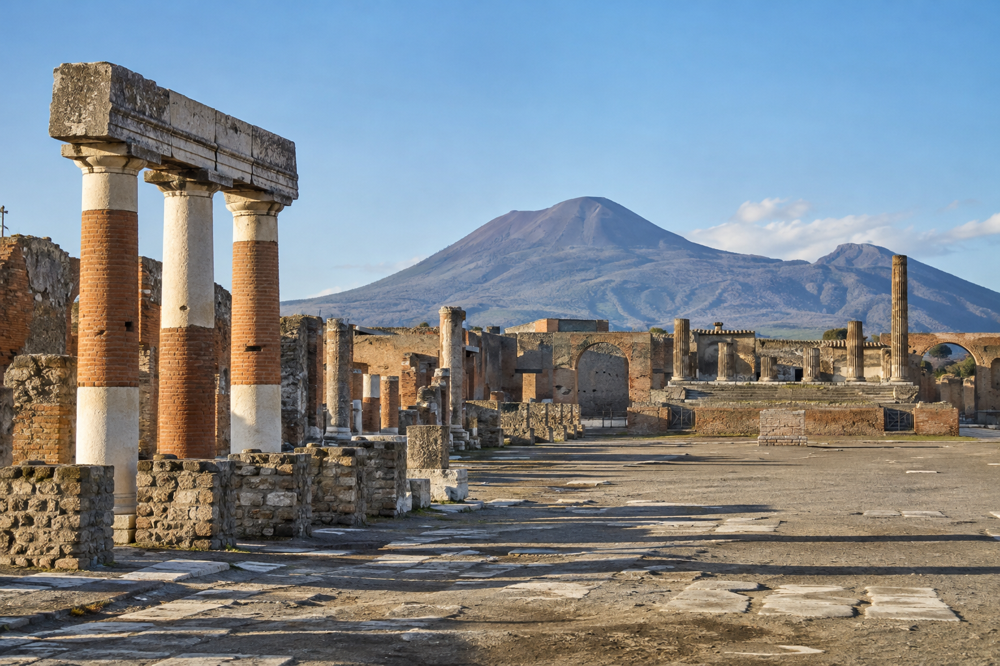
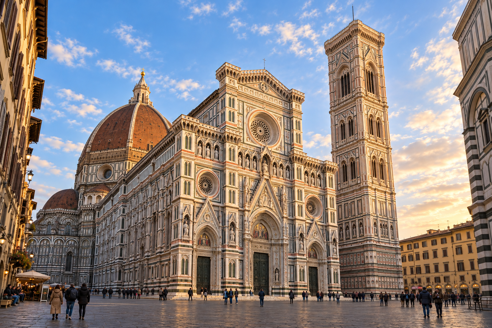

# Trips4Troops tour imagery

**Christmas in Rome — generated drafts, not approved for website publication.**

This branch contains 13 individual PNG images: one banner, six daily itinerary images, and six highlights. Landmark verification remains incomplete; Capri requires correction. Tours 2–25 imagery has not started.

Browse the images below or open the [image folder](tour-images/01_Christmas_in_Rome). The [manifest](tour-images/01_Christmas_in_Rome/manifest.json) maps dates and placements; the [QA report](tour-images/01_Christmas_in_Rome/QA.md) records outstanding issues.

These are AI-generated destination illustrations, not photographs of the future December 23–28, 2026 trip. December 26 excursion images represent optional destinations.

## Christmas in Rome banner

[Open full image](tour-images/01_Christmas_in_Rome/banner/Rome_Banner.png)

## Itinerary Day 1 — Evening departure by coach

[Open full image](tour-images/01_Christmas_in_Rome/daily/Rome_Day01.png)

## Itinerary Day 2 — Rome arrival, city tour, Midnight Mass at St. Peter’s Square

[Open full image](tour-images/01_Christmas_in_Rome/daily/Rome_Day02.png)

## Itinerary Day 3 — Christmas Day, Urbi et Orbi, Rome sightseeing

[Open full image](tour-images/01_Christmas_in_Rome/daily/Rome_Day03.png)

## Itinerary Day 4 — Optional Naples & Beyond: Pompeii, Capri, Sorrento (optional)

[Open full image](tour-images/01_Christmas_in_Rome/daily/Rome_Day04.png)

## Itinerary Day 5 — Florence guided walking tour; departure for home

[Open full image](tour-images/01_Christmas_in_Rome/daily/Rome_Day05.png)

## Itinerary Day 6 — Morning arrival home

[Open full image](tour-images/01_Christmas_in_Rome/daily/Rome_Day06.png)

## Highlight — StPeters

[Open full image](tour-images/01_Christmas_in_Rome/highlights/Rome_Highlight01_StPeters.png)

## Highlight — Naples (optional)

[Open full image](tour-images/01_Christmas_in_Rome/highlights/Rome_Highlight02_Naples.png)

## Highlight — Pompeii (optional)

[Open full image](tour-images/01_Christmas_in_Rome/highlights/Rome_Highlight03_Pompeii.png)

## Highlight — Capri (optional)

[Open full image](tour-images/01_Christmas_in_Rome/highlights/Rome_Highlight04_Capri.png)

## Highlight — Sorrento (optional)

[Open full image](tour-images/01_Christmas_in_Rome/highlights/Rome_Highlight05_Sorrento.png)

## Highlight — Florence

[Open full image](tour-images/01_Christmas_in_Rome/highlights/Rome_Highlight06_Florence.png)
