# Trips4Troops tour imagery

**Christmas in Rome (December 23–28, 2026): AI-generated drafts. Not yet approved for the website.**

13 images: one banner, six itinerary days and six highlights. A [landmark review](tour-images/01_Christmas_in_Rome/LANDMARK_REVIEW.md) checked each one against the real sites. 6 are usable, 2 need a quick check against a photo and 5 need regenerating. The review includes corrected prompts for those 5.

These are illustrations, not photographs of the trip. December 26 excursion images show optional destinations. Imagery for tours 2–25 has not started.

- [Manifest](tour-images/01_Christmas_in_Rome/manifest.json): dates, placements, alt text and review verdicts
- [Web-ready WebP images](tour-images/01_Christmas_in_Rome/web) (1600 px and 800 px, ~1 MB total at 800 px versus 37 MB of PNGs) with [`images.json`](tour-images/01_Christmas_in_Rome/web/images.json) for `srcset`; rebuild with `python3 tools/build_web_images.py tour-images/01_Christmas_in_Rome`
- [Earlier QA notes](tour-images/01_Christmas_in_Rome/QA.md)

| Image | Verdict | Finding |
|---|---|---|
| Banner | ❌ Regenerate | Dome drum shown fully above the facade (hidden by the nave from inside the square); tree stands apart from the obelisk. |
| Day 1 — Evening departure by coach | ❌ Regenerate | Steering wheel on the right with the passenger door also on the right; continental coaches are left-hand drive. |
| Day 2 — Rome arrival, city tour, Midnight Mass at St. Peter’s Square | 🟡 Check against a photo | Dome somewhat over-exposed for a view from inside the square; tree, nativity, obelisk and Apostolic Palace placement consistent. |
| Day 3 — Christmas Day, Urbi et Orbi, Rome sightseeing | ❌ Regenerate | Garbled pseudo-Latin on the facade frieze and obelisk base; full dome visible from beside the obelisk. |
| Day 4 — Optional Naples & Beyond: Pompeii, Capri, Sorrento | ✅ Usable | Forum oriented correctly toward the Temple of Jupiter with Vesuvius behind; foreground column style is approximate. |
| Day 5 — Florence guided walking tour; departure for home | ❌ Regenerate | Brunelleschi's dome placed beside the facade instead of directly behind it; Baptistery shown in an impossible position. |
| Day 6 — Morning arrival home | ✅ Usable | Generic sunrise arrival; no landmarks. |
| Highlight — St Peter's | ✅ Usable | Colonnade interior with obelisk and tree side by side; consistent. |
| Highlight — Naples (optional) | ✅ Usable | Castel dell'Ovo with Vesuvius behind; Somma ridge on the correct side. |
| Highlight — Pompeii (optional) | ✅ Usable | Generic excavated street with stepping stones; no specific street claimed. |
| Highlight — Capri (optional) | ❌ Regenerate | Middle Faraglione far too small, arch shown as a small cave rather than a through-tunnel, Stella detached from the island. |
| Highlight — Sorrento (optional) | ✅ Usable | Generic marina below tufa cliffs, in keeping with Marina Grande. |
| Highlight — Florence | 🟡 Check against a photo | Ponte Vecchio broadly correct; verify Vasari Corridor window rhythm. |

## Banner

❌ Regenerate: Dome drum shown fully above the facade (hidden by the nave from inside the square); tree stands apart from the obelisk.

[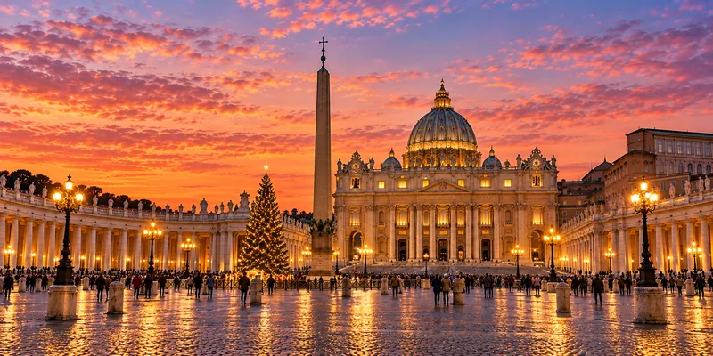](tour-images/01_Christmas_in_Rome/banner/Rome_Banner.png)

## Day 1 — Evening departure by coach

❌ Regenerate: Steering wheel on the right with the passenger door also on the right; continental coaches are left-hand drive.

[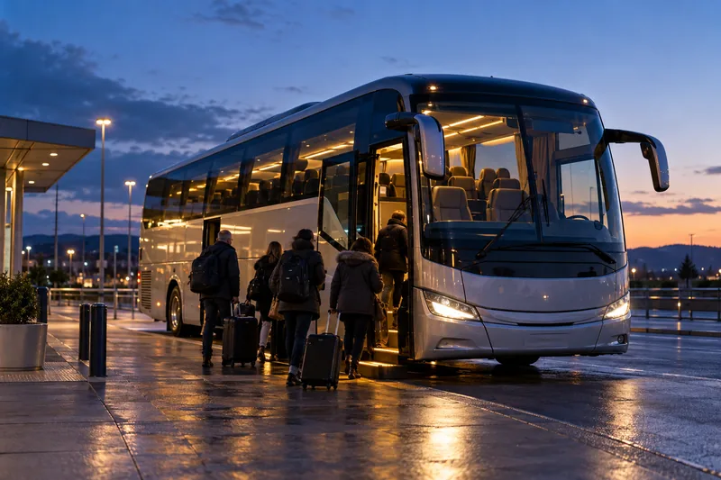](tour-images/01_Christmas_in_Rome/daily/Rome_Day01.png)

## Day 2 — Rome arrival, city tour, Midnight Mass at St. Peter’s Square

🟡 Check against a photo: Dome somewhat over-exposed for a view from inside the square; tree, nativity, obelisk and Apostolic Palace placement consistent.

[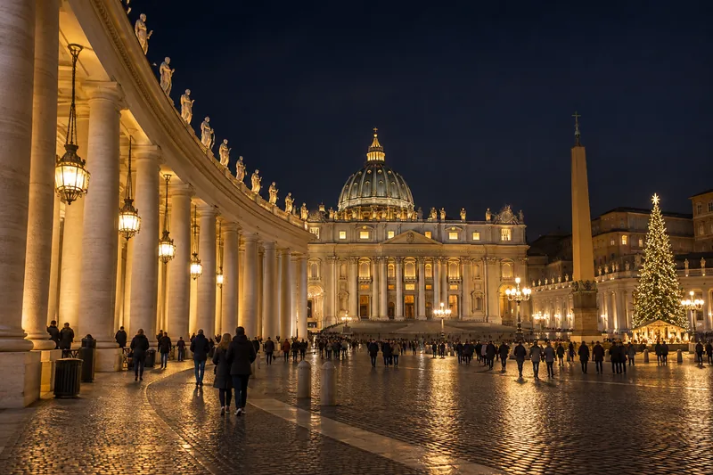](tour-images/01_Christmas_in_Rome/daily/Rome_Day02.png)

## Day 3 — Christmas Day, Urbi et Orbi, Rome sightseeing

❌ Regenerate: Garbled pseudo-Latin on the facade frieze and obelisk base; full dome visible from beside the obelisk.

[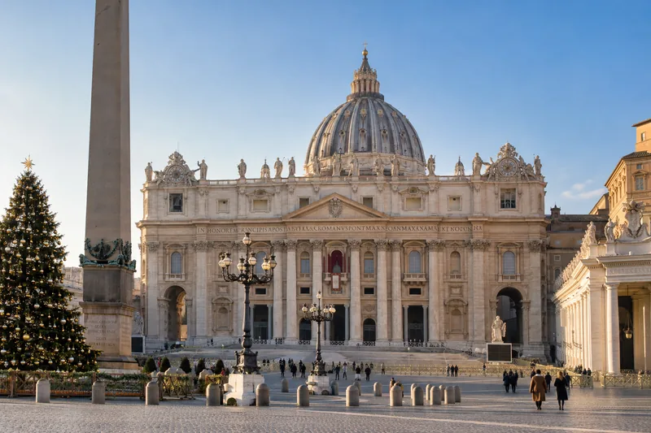](tour-images/01_Christmas_in_Rome/daily/Rome_Day03.png)

## Day 4 — Optional Naples & Beyond: Pompeii, Capri, Sorrento

✅ Usable: Forum oriented correctly toward the Temple of Jupiter with Vesuvius behind; foreground column style is approximate.

[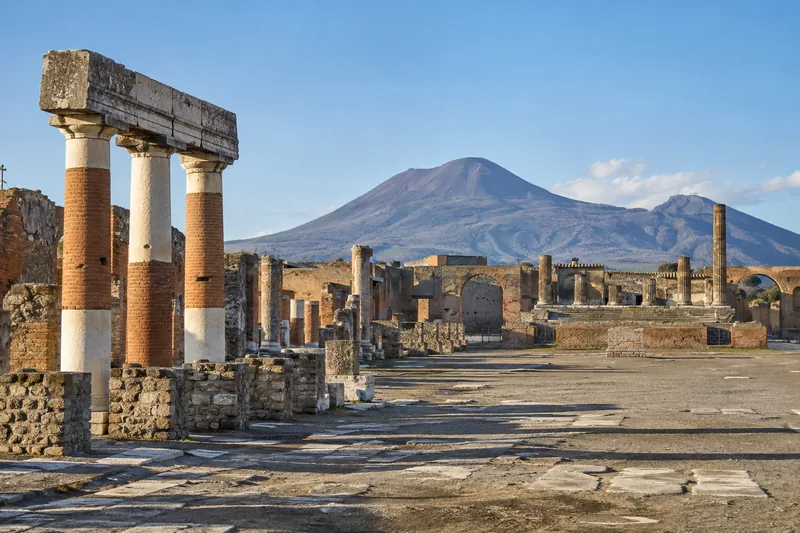](tour-images/01_Christmas_in_Rome/daily/Rome_Day04.png)

## Day 5 — Florence guided walking tour; departure for home

❌ Regenerate: Brunelleschi's dome placed beside the facade instead of directly behind it; Baptistery shown in an impossible position.

## Day 6 — Morning arrival home

✅ Usable: Generic sunrise arrival; no landmarks.

[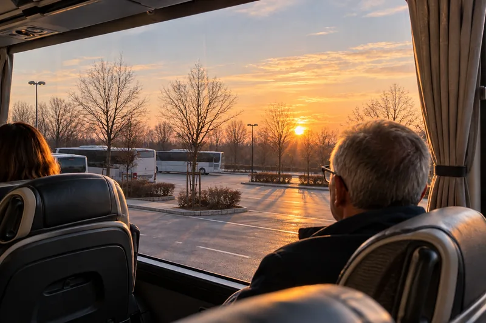](tour-images/01_Christmas_in_Rome/daily/Rome_Day06.png)

## Highlight — St Peter's

✅ Usable: Colonnade interior with obelisk and tree side by side; consistent.

[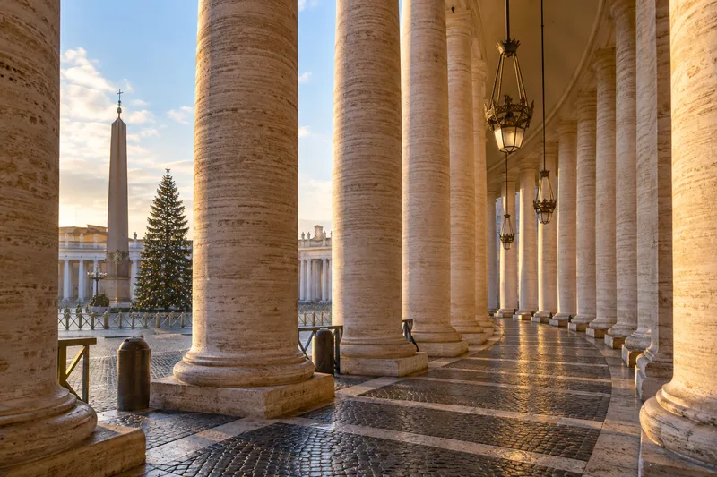](tour-images/01_Christmas_in_Rome/highlights/Rome_Highlight01_StPeters.png)

## Highlight — Naples (optional)

✅ Usable: Castel dell'Ovo with Vesuvius behind; Somma ridge on the correct side.

[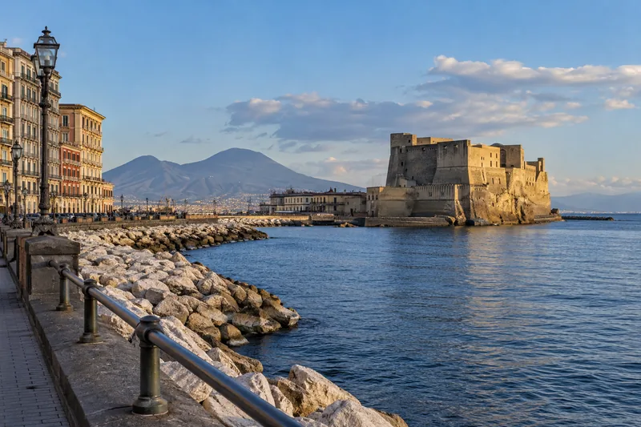](tour-images/01_Christmas_in_Rome/highlights/Rome_Highlight02_Naples.png)

## Highlight — Pompeii (optional)

✅ Usable: Generic excavated street with stepping stones; no specific street claimed.

[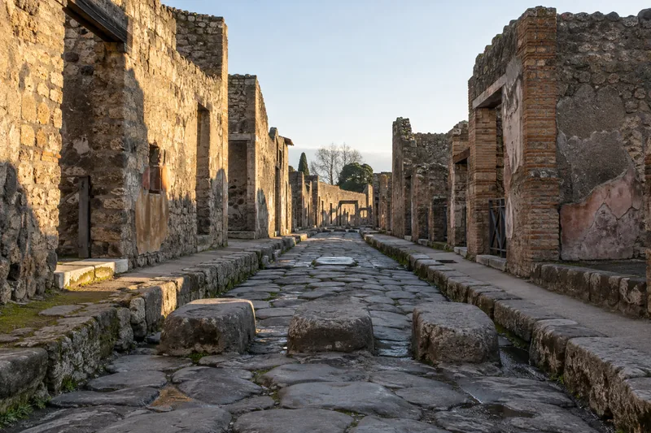](tour-images/01_Christmas_in_Rome/highlights/Rome_Highlight03_Pompeii.png)

## Highlight — Capri (optional)

❌ Regenerate: Middle Faraglione far too small, arch shown as a small cave rather than a through-tunnel, Stella detached from the island.

[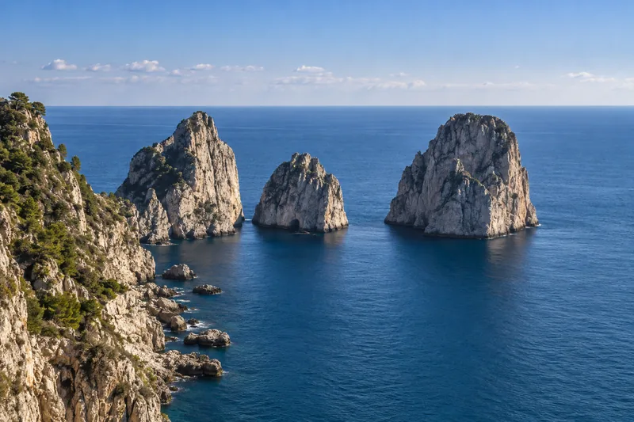](tour-images/01_Christmas_in_Rome/highlights/Rome_Highlight04_Capri.png)

## Highlight — Sorrento (optional)

✅ Usable: Generic marina below tufa cliffs, in keeping with Marina Grande.

[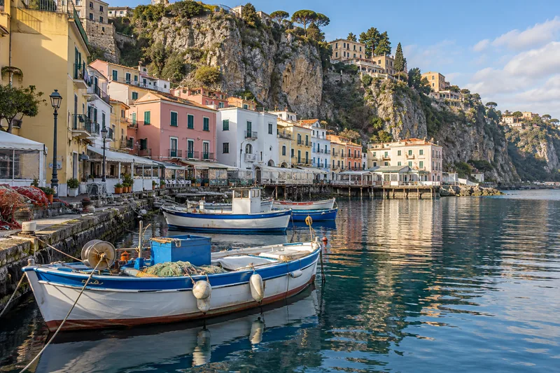](tour-images/01_Christmas_in_Rome/highlights/Rome_Highlight05_Sorrento.png)

## Highlight — Florence

🟡 Check against a photo: Ponte Vecchio broadly correct; verify Vasari Corridor window rhythm.

[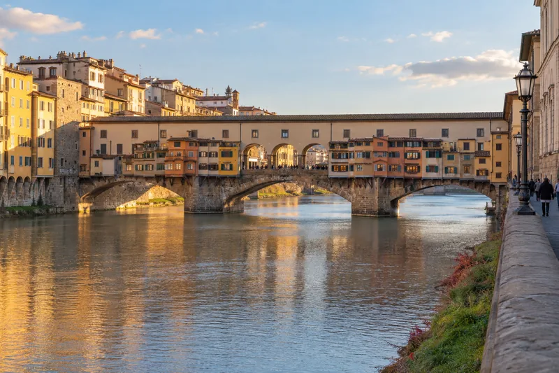](tour-images/01_Christmas_in_Rome/highlights/Rome_Highlight06_Florence.png)
