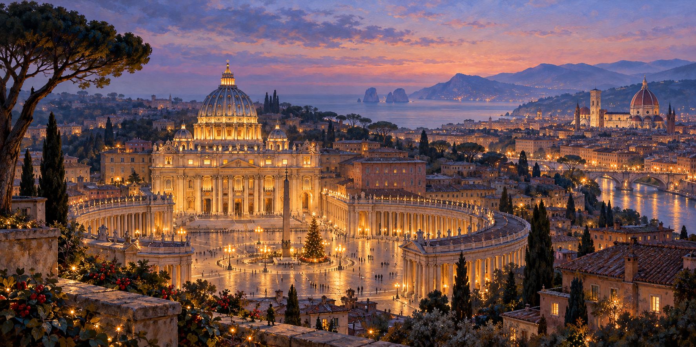

# Trips4Troops tour imagery

## Christmas in Rome — revised banner direction

**Style sample, not a final approved banner.** One continuous painterly composition evoking the tour, with no panels, inset photos or strips of highlights. The places are joined symbolically through light and atmosphere; this is not a literal geographic view.

[Open the full banner](tour-images/01_Christmas_in_Rome/banner/Rome_Banner.png) · [Creative direction](tour-images/CREATIVE_DIRECTION.md)

## Improved highlights — real photography

The six highlight images have been replaced with licensed real photographs. [View the highlight gallery](tour-images/01_Christmas_in_Rome/highlights/README.md). They belong separately in the program and summary, with [photo credits](tour-images/01_Christmas_in_Rome/highlights/CREDITS.md). Naples, Pompeii, Capri and Sorrento remain optional. Source photos represent their destinations; capture dates and seasons differ from the future December trip.

The six daily AI images remain rejected and still need replacement.

This sample still needs style feedback, landmark checks and crop refinement; Florence is near the right edge. Optional southern Italy destinations remain optional. No image depicts the actual future Christmas ceremony.

[Manifest](tour-images/01_Christmas_in_Rome/manifest.json) · [Review notes](tour-images/01_Christmas_in_Rome/QA.md)

Tours 2–25 imagery remains unstarted while Rome is refined.
