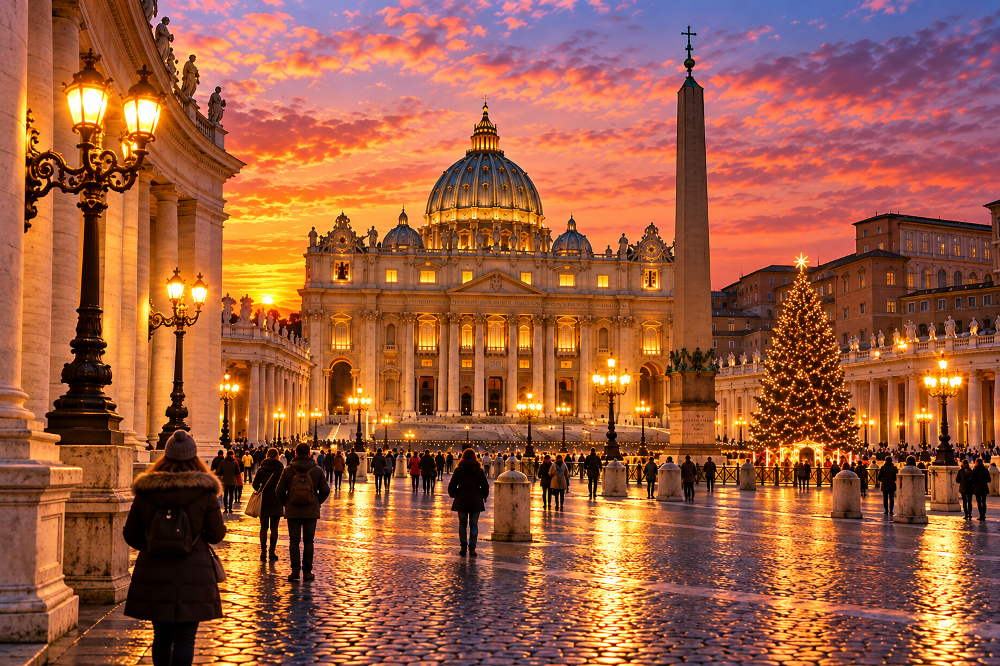
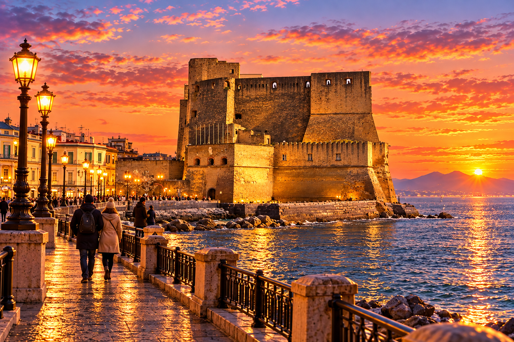
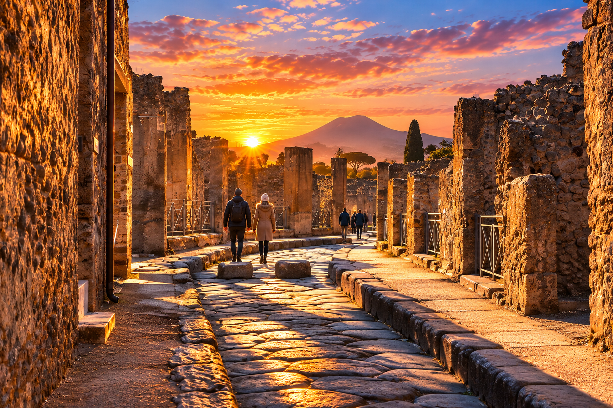
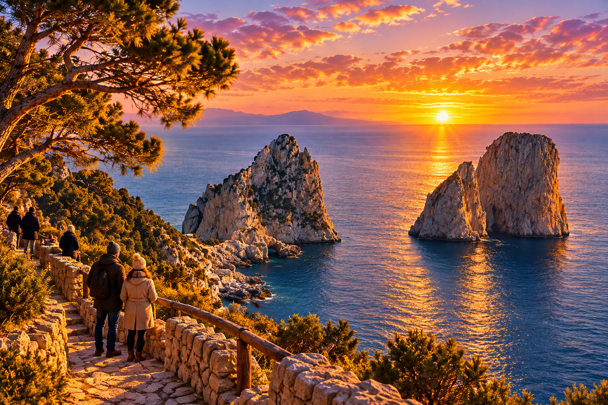
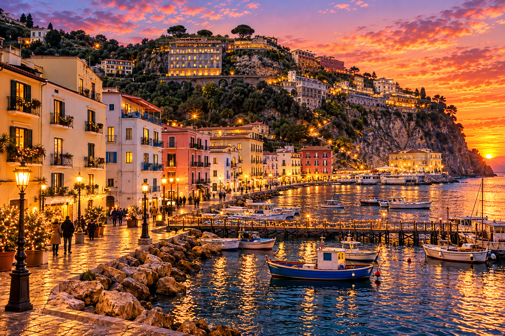
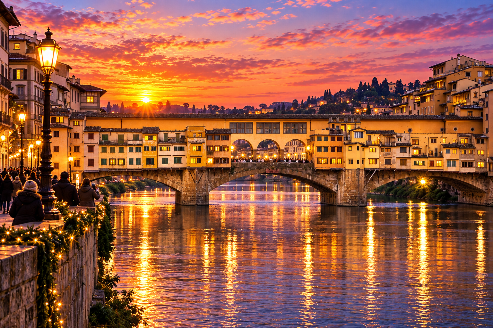

# Christmas in Rome — generated highlights

Six separate images in the warm, cinematic style of the original Rome banner. No panels or text overlays.

Naples, Pompeii, Capri and Sorrento represent the optional December 26 excursion.

## St. Peter’s at Christmas

[Open image](Rome_Highlight01_StPeters.png)

## Naples — optional

[Open image](Rome_Highlight02_Naples.png)

## Pompeii — optional

[Open image](Rome_Highlight03_Pompeii.png)

## Capri — optional

[Open image](Rome_Highlight04_Capri.png)

## Sorrento — optional

[Open image](Rome_Highlight05_Sorrento.png)

## Florence

[Open image](Rome_Highlight06_Florence.png)

---

Generated artwork. [Reference credits and licenses](CREDITS.md).